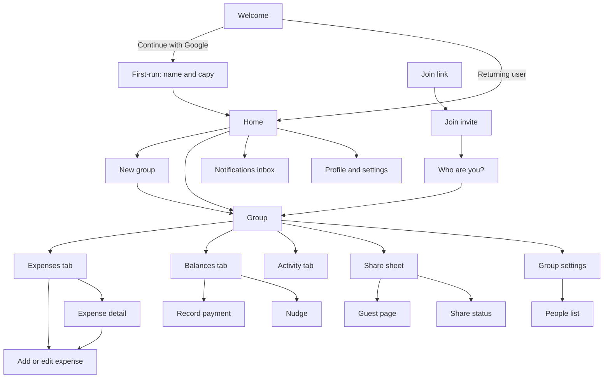
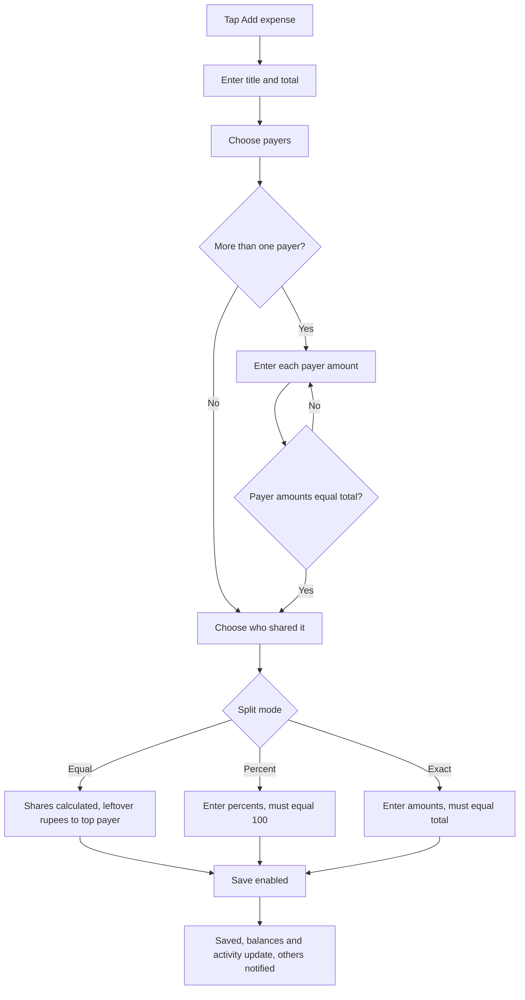
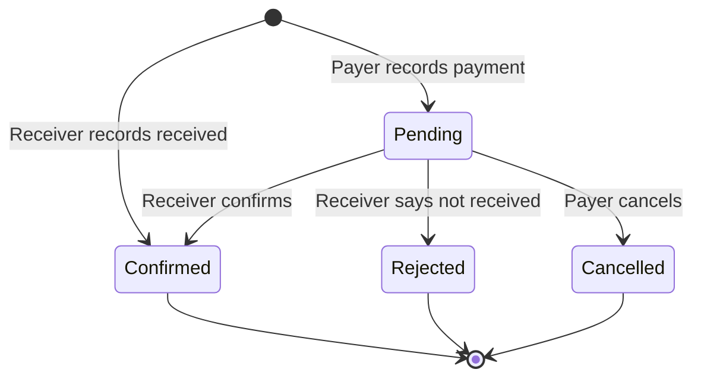
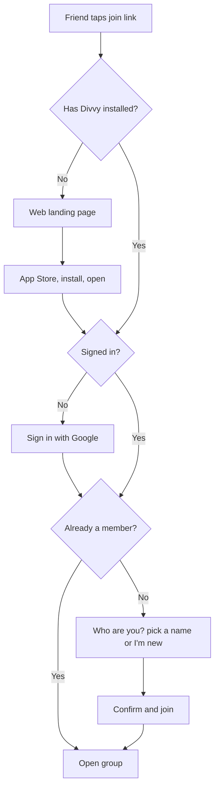

# Divvy User Flows

Every user flow in the app: who does it, what they see, what can go wrong, and what the capybara says.
Built on the product rules in `design.md` section 8 and the screens in section 7.

**Tags:** `[MVP]` ships in version 1. `[V1.1]` soon after. `[LATER]` parked.
**Decisions marked "Default"** are my proposals. Change any of them and the flow updates with it. They are collected in section 14.

---

## 0. Foundations

### 0.1 Roles

| Role | Who | Has an account | Can do |
|---|---|---|---|
| **Owner** | Created the group | Yes | Everything a member can, plus rename, remove people, regenerate links, archive or delete the group, confirm payments on behalf of people without accounts |
| **Member** | Joined with an account and is linked to a person in the group | Yes | Add expenses, edit or delete **their own** expenses, record and confirm payments, add people by name, nudge, share status |
| **Named person** | Added by name, no account (yet) | No | Appears in splits, balances and activity. Cannot act. Becomes a Member when someone links an account to them. |
| **Guest** | Opens a view link | No | Read balances and the expense list. Nothing else. |

### 0.2 Permission matrix

| Action | Owner | Member | Named person | Guest |
|---|---|---|---|---|
| See balances, expenses, activity | Yes | Yes | n/a | Balances and expenses only |
| Add expense | Yes | Yes | n/a | No |
| Edit or delete an expense | Own only | Own only | n/a | No |
| Add a person by name | Yes | Yes | n/a | No |
| Rename a person | Yes | Self only | n/a | No |
| Remove a person | Yes (rules in 5.4) | No | n/a | No |
| Record a payment as payer | Yes | Yes (own payments) | n/a | No |
| Confirm or reject a payment | Receiver, or owner if receiver has no account | Receiver | n/a | No |
| Nudge someone | Yes | Yes | n/a | No |
| Regenerate join or view link | Yes | No | n/a | No |
| Rename, archive, delete group | Yes | No | n/a | No |
| Leave group | Yes (after transfer) | Yes | n/a | n/a |

### 0.3 Objects and their states

**Expense:** `active` → `edited` (still active, with history) → `deleted` (soft, kept in log, excluded from balances).

**Payment (settlement):** `pending` → `confirmed` or `rejected` or `cancelled`. Only `confirmed` changes balances.

**Person in a group:** `named` (no account) → `linked` (account attached) → `left` (account detached, name stays) or `removed` (only when balance is 0).

**Group:** `active` → `archived` (read only, hidden from home) → `deleted` (everything removed after a 30-day grace period, Default).

**Link:** `valid` → `regenerated` (old one stops working at once). Join link and view link are independent.

### 0.4 Global conventions

- Money is whole rupees (`Rs 2,000`). Leftover rupees from an uneven split go to the person who paid the most, with a one-line note.
- Signed amounts: `+Rs 2,000` owed to you, `−Rs 2,000` you owe.
- Every write creates an **activity** entry with who, what, when, and old and new values.
- Pending screens always say who is being waited on.
- Offline: reads work from cache, writes queue and sync (flow 11.1).
- The capybara appears once per screen as host (see section 12).

### 0.5 Flow index

| # | Flow | Tag |
|---|---|---|
| 1 | First launch and sign-in | MVP |
| 2 | First-run profile (name and capy) | MVP |
| 3 | Returning user, session, sign-out, delete account | MVP |
| 4 | Home (groups list) | MVP |
| 5 | Groups: create, open, settings, members, archive, delete, leave | MVP |
| 6 | Inviting and joining (join link) | MVP |
| 7 | Guest view link | MVP |
| 8 | Expenses: add, view, edit, delete | MVP |
| 9 | Balances and settling up | MVP |
| 10 | Nudges, notifications and activity | MVP / V1.1 |
| 11 | System flows: offline, errors, permissions, deep links | MVP |
| 12 | Capybara moments | MVP |
| 13 | Screen inventory and navigation map | MVP |
| 14 | Open decisions | n/a |

---

## 1. First launch and sign-in `[MVP]`

**Actor:** anyone new. **Screen:** Welcome.

### 1.1 Happy path
1. App opens to **Welcome**: capybara host, bubble "Chill. We'll split it.", headline, **Continue with Google**, fine print "Friends without the app can follow along from a link."
2. Tap **Continue with Google**. The system Google sheet opens.
3. Pick an account and approve.
4. App creates the profile (name and photo from Google, a default capybara).
5. New user goes to **First-run profile** (flow 2). Returning user goes straight to **Home** (flow 4).

### 1.2 Alternate and error paths
| Situation | What happens |
|---|---|
| User cancels the Google sheet | Back to Welcome, no error toast. Button stays enabled. |
| No network | Inline message under the button: "No connection. Check your internet and try again." Button re-enabled. |
| Google returns an error | Toast: "Couldn't sign you in. Try again." Log the error code. |
| Account is already signed in on another device | Allowed. Same account, same data, synced. |
| User arrived from a join link | Sign-in succeeds, then continue into the join flow (6.2) instead of Home. The pending link is remembered through sign-in and the first-run profile. |
| User arrived from a view link | They see the guest page first (flow 7). "Join in the app" leads here. |

**Apple requirement `[MVP before App Store]`:** because Google sign-in is offered, add **Sign in with Apple** as a second button. Both lead to the same profile creation. This needs the paid Apple Developer account, so it is built last but gated for release.

---

## 2. First-run profile `[MVP]`

**Actor:** new user right after first sign-in. **Screens:** Pick your capy, optional name edit.

1. **Name:** prefilled from Google ("Amal"). Editable. Required, 1 to 30 characters.
2. **Pick your capy:** large preview of the selected outfit on a lilac stage, a 5 × 2 grid of the ten head avatars, **Continue**. Tapping a head swaps the preview with a small bounce.
3. **Skip** is available. Skipping keeps the default capybara (Divvy, outfit 1). The user can change it later (flow 3.5).
4. Land on **Home** (empty state, 4.2) or continue the pending join link.

Edge cases:
- Name is blank → Continue disabled, helper text "Add a name your friends know you by."
- Name matches a named person in a group they are joining → handled in the join flow (6.3), not here.

---

## 3. Returning user, session, account `[MVP]`

### 3.1 Returning user
1. App opens with a short splash (capybara head on lilac).
2. If the session is valid, go to **Home**. Cached data shows immediately, then syncs.
3. If the session expired, show **Welcome** with the toast "Please sign in again." Any queued offline changes are kept and sent after sign-in (11.1).

### 3.2 Profile and settings
Opened from the avatar on Home. A bottom sheet:
- Name, capybara outfit (opens 3.5), appearance (Auto, Light, Dark), notifications (opens 10.4), **Sign out**, **Delete account**, app version.

### 3.3 Sign out
1. Tap **Sign out** → confirm sheet "Sign out of Divvy? Your groups stay safe."
2. Local cache is cleared. Return to Welcome.
3. Queued but unsynced changes: warn first. "You have 2 changes waiting to sync. Sign out anyway?" with **Stay signed in** as the default action.

### 3.4 Delete account `[MVP]` (required by App Store)
1. Settings → **Delete account**.
2. Sheet explains: "Your name is removed from your groups. Your expenses and balances stay as a plain name so friends keep an accurate record."
3. If the user **owns** groups with other members, they must first transfer ownership or delete those groups (flow 5.9). The sheet lists them with a button for each.
4. Type the word `DELETE` to confirm. Button is destructive-soft, never solid red.
5. Account and Google link are deleted. Every person linked to this account becomes a **named person** (not removed). Personal data (email, photo) is erased.
6. Return to Welcome with a toast "Account deleted."

### 3.5 Change my capy or name
Settings → Pick your capy (same screen as flow 2). Saving updates the avatar everywhere, live. Activity entries are not rewritten.

---

## 4. Home (groups list) `[MVP]`

**Screen:** Home. Hero tile "You're owed Rs X" (or "You owe Rs X"), group bento tiles, **New group** tile, floating tab bar.

### 4.1 Populated
- Hero sums balances across all active groups: owed total and owing total. Tapping **Settle up** goes to the first group where the user owes money, or hides if nobody owes.
- Each group tile: icon, name, people count, status pill (`+Rs 2,000`, `−Rs 1,500` or "All settled"). Sorted by most recent activity.
- Tap a tile → Group (5.2).
- Pull to refresh, though data is live anyway.

### 4.2 Empty state (no groups)
- Capybara 8 (Wide open) on a lilac tile, "No groups yet. Create one and add the people you split with." Primary button **New group**.

### 4.3 Tab bar destinations
| Tab | Screen |
|---|---|
| Home | Groups list |
| Activity | Cross-group activity feed `[V1.1]`. In MVP this tab opens the notification inbox (10.3). |
| People | Everyone the user shares groups with, and what they owe each other in total `[V1.1]` |
| Profile | Settings sheet (3.2) |

### 4.4 Search `[V1.1]`
Search icon filters groups by name and people by name.

### 4.5 Archived groups
Hidden from Home. Settings → **Archived groups** lists them, read only, with **Restore** for owners.

---

## 5. Groups `[MVP]`

### 5.1 Create a group
1. Home → **New group**.
2. **Name** (required, 1 to 40 characters). Optional icon choice (fork, car, home, bag, party) which also sets the tile colour.
3. **Who's in?** The creator is already added. Type a name and tap **Add** (or Return) to add each person. Chips show added people, each with an × to remove.
4. Tap **Create group**.
5. Group opens on the Expenses tab with the empty state: capybara 8, "No expenses yet. Add the first one." plus a **Share** nudge strip (6.1).
6. Activity entry: "Amal created the group."

Rules and errors:
- Name empty → Create disabled.
- Duplicate names inside a group are allowed but flagged: "You already have a Nimal. Add a last initial so you can tell them apart?" with **Keep both** and **Rename**.
- Maximum 30 people per group (Default). At the limit, Add is disabled with an explanation.
- Group with only the creator is allowed (people can join later).

### 5.2 Open a group
Header: back, group name, face stack, share. Tabs: **Expenses**, **Balances**, **Activity**. Ink card at the top shows the most relevant debt for the viewer:
- If someone owes the viewer: "Ravi owes you Rs 2,000" with a **Nudge** button.
- If the viewer owes: "You owe Ravi Rs 2,000" with a **Pay** button (goes to record payment, 9.2).
- If settled: "All settled" with the Sweet capybara.
- If several debts exist: the largest is shown, with "+2 more" opening Balances.
Bottom button: **Add expense** (hidden when the group is archived).

### 5.3 Group settings
Group header has two buttons: **People and settings** (people icon, also opened by tapping the face stack) and **Share**. People and settings opens a sheet with:
- Rename (owner), icon and colour (owner), **People** (5.4, with add person), **Archive** (5.8), **Leave group** (5.9), **Delete group** (5.10, owner). Link management stays in the Share sheet (6.5, 7.4).

### 5.4 People in a group

**List:** avatar, name, status ("Named", "Joined", "Owner"), balance.

| Action | Who | Flow |
|---|---|---|
| **Add person** by name | Owner, Member | Type name → added as named person. Activity entry. |
| **Rename person** | Owner (anyone), person themselves | Updates everywhere. Old name stays in old activity text. |
| **Link my account to this person** | Joining user | Via join link (6.3) |
| **Unlink** (wrong person was claimed) | Owner | Person returns to named. Their expenses stay with the person. |
| **Remove person** | Owner | See rules below |

**Remove person rules**
1. The person's **balance must be Rs 0**. Otherwise blocked: "Ravi still owes Rs 2,000. Settle up first."
2. If the person appears in past expenses, they are **not deleted**. They are marked "Former member": hidden from new-expense pickers, kept in history.
3. If they never appear in any expense, they are deleted outright.
4. A pending payment involving them must be resolved first.

### 5.5 Rename or change the group
Owner edits name and icon. Everyone sees it live. Activity: "Amal renamed the group to Ella trip."

### 5.6 Group-level totals
Expenses tab header tiles: **Total spent** (sum of active expenses) and **Your share** (sum of the viewer's shares, excluding deleted).

### 5.7 Filters and sort on Expenses `[V1.1]`
Sort by newest or amount. Filter by payer or person.

### 5.8 Archive a group `[V1.1]`
1. Owner → Settings → **Archive**. Only allowed when **all balances are 0** and no payment is pending.
2. The group disappears from Home and becomes read only.
3. New expenses are blocked with "This group is archived. Restore it to add more."
4. **Restore** from Archived groups.

### 5.9 Leave a group
1. Member → Settings → **Leave group**.
2. If the member's balance is not 0: blocked with "Settle up before you leave." and a link to Balances.
3. If the member is the **only owner** and others remain: they must **Transfer ownership** to another linked member first (picker). If nobody else has an account, they can only delete the group.
4. Confirm. The account is detached. The person remains in history as a **named person** (their past expenses stay accurate).
5. Activity: "Kasun left the group."

### 5.10 Delete a group (owner)
1. Settings → **Delete group**.
2. Warning lists consequences: all expenses, balances, links and activity are removed for everyone.
3. Type the group name to confirm.
4. Members receive a notification: "Ella weekend was deleted by Amal."
5. 30-day grace period where the owner can restore it (Default), then permanent erase.
6. Both links stop working immediately.

---

## 6. Inviting and joining `[MVP]`

### 6.1 Share the join link (inviter)
1. Group → **Share** (header icon or the strip on an empty group).
2. Share sheet shows two cards: **Join link** (for friends who will add expenses) and **View link** (7.1). Each has **Copy**.
3. **Share** opens the iOS share sheet with a ready message: "Join 'Lunch out' on Divvy: https://divvy.app/j/Ab3dE9".
4. The link is permanent until the owner regenerates it (6.5).

### 6.2 Join via link: friend already has Divvy
1. Friend taps the link in WhatsApp. iOS opens Divvy via a universal link.
2. If signed out, they sign in first (flow 1). The link is remembered.
3. Join screen: capybara host, "Amal invited you to **Lunch out**." Shows group name, face stack, and the people who haven't joined yet.
4. **"Who are you?"** list of unclaimed named persons plus **"I'm someone new"**.
5. Tap a name (for example "I'm Nimal") → confirm sheet → **Join**.
6. The account links to that person. Past expenses involving Nimal now show as theirs. Land in the group.
7. Activity: "Nimal joined."

### 6.3 Choosing a person: rules and edge cases
| Situation | Behavior |
|---|---|
| User picks **"I'm someone new"** | A new person is created with their profile name and added to the group. They are in no past expenses. |
| Their name matches an unclaimed person | That person is pre-highlighted with "Is this you?" |
| User picks the wrong person | Owner can **Unlink** (5.4). Picker also has a confirm step to reduce mistakes. |
| All named persons are claimed | Only "I'm someone new" appears. |
| User is already a member | Link opens the group directly with the toast "You're already in Lunch out." |
| Person is already linked to another account | Not shown in the list. |

### 6.4 Join via link: friend does not have Divvy
1. Link opens a **web landing page** (divvy.app/j/…): group name, face stack, capybara, **Get the app** (App Store) and **View balances** (opens the guest page, 7.1).
2. After install and first open, the app resumes the invite (deferred deep link). If that is unavailable, the app asks "Have an invite link? Paste it here." with a paste button.
3. Continues as 6.2.

### 6.5 Link management (owner)
- **Regenerate join link:** confirm "The old link will stop working." New link shown. People who already joined are unaffected.
- **Disable join link** `[V1.1]`: stops new joins without making a new link.
- Invalid or regenerated link opened by a friend → screen with the Cool capybara: "This link isn't working. Ask Amal for a new one." Button **Open Divvy**.

### 6.6 Join requests `[LATER]`
Owner approval before someone joins. Not in v1.

---

## 7. Guest view link `[MVP]`

### 7.1 Guest opens a view link
1. Link opens in the browser (no install, no login) on a read-only page: group name, "Shared by Amal", people count and total spent.
2. Sections: **Who owes what** (each person with owes or is owed), **To settle up** (suggested payments), **Expenses** (title, payer names, date, amount).
3. Page updates live while open.
4. Banner shows the Chill capybara and "View only. You can't change anything here."
5. **Join in the app** leads to the install or join flow (6.4).

Not shown to guests: the activity log, payment pending status, member emails, and the join link.

### 7.2 Guest edge cases
| Situation | Behavior |
|---|---|
| Link regenerated | Page shows "This link was turned off." with the Cool capybara |
| Group archived | Page still works, labelled "Archived" |
| Group deleted | "This group no longer exists." |
| Very long list | First 50 expenses, then "Open the app to see all." |
| Slow or offline | Last loaded data stays on screen with a "Reconnecting…" strip |

### 7.3 Privacy
Anyone with the view link can see amounts and first names. The share sheet says so: "Anyone with this link can see the balances. You can turn it off any time."

### 7.4 Turn off or replace the view link
Owner → Links → **New view link** (old one dies) or **Turn off view link** `[V1.1]`.

---

## 8. Expenses `[MVP]`

### 8.1 Add an expense
**Entry points:** **Add expense** bottom button (group), floating plus (Home, uses the group picker first).

Step by step (screen "New expense"):
1. **Title** chip. Required. Quick suggestions: Lunch, Dinner, Taxi, Groceries, Tickets, Rent.
2. **Total amount.** Large numeric field, whole rupees only. Decimals are blocked by the keypad.
3. **Who paid and how to split** is one merged card (no separate "who paid" and "who shared" blocks):
   - A **split mode** control sits on top: Equal, Percent, Exact.
   - One row per person: a tick box (shared it or not), avatar, name, a **Paid** field, and a **Share** column.
   - **Paid:** type what each person paid, leave it empty if they didn't pay. The creator is prefilled with the full total until anyone edits a Paid field.
   - **Share:** Equal shows the computed amount, Percent shows a % field (with the rupee amount under the name), Exact shows a rupee field. Unticked people show a dash and are excluded from the split. At least one person must stay ticked.
   - A live status line under the card reads "Paid Rs 8,000 of Rs 10,000 · Rs 2,000 left", turning green at "Paid Rs 10,000 of Rs 10,000". Percent and Exact modes add a second line, for example "Shares: 20% left".
4. **Split modes** are described in 8.2 to 8.4 and apply to the Share column.
5. (Merged into step 3.)
6. Optional fields (collapsed under "More"): **Date** (default today), **Note**, **Category icon** `[V1.1]`.
7. **Save expense** enabled only when every check passes. When disabled, a one-line hint says why: "Paid amounts must add up to Rs 10,000".
8. On save: toast "Expense added. Everyone sees it now." with Hype capybara. Group shows the new expense at the top. Balances update live. Activity entry written. Other members get a notification (10.2).

**Cancel:** × or swipe down. If anything was typed, confirm "Discard this expense?" with **Keep editing** as the default.

### 8.2 Split: Equal
- Shares shown per ticked person.
- If the total does not divide evenly, a note appears: "Rs 10,000 doesn't divide evenly across 3, so Rs 1 extra goes to Amal, who paid the most. Whole rupees only."
- Example: Rs 10,000 among 3 → 3,334 / 3,333 / 3,333.
- Example from the lunch: Rs 10,000 among 5 → Rs 2,000 each.

### 8.3 Split: Percent
- One percent field per ticked person. **Fill equal percentages** helper.
- Status line: "80% · 20% left", "120% · 20% over", green "Adds up to 100%".
- Save stays disabled until exactly 100% (checked to two decimals).
- Each person's rupee amount is previewed ("≈ Rs 2,000"). On save, amounts are rounded down and leftover rupees go to the person with the largest percentage.

### 8.4 Split: Exact amounts
- One rupee field per ticked person. **Fill equal amounts** helper.
- Status line shows "Rs 1,500 left to assign" or "Rs 500 over", green at "Adds up to Rs 10,000".
- Save disabled until the amounts equal the total.

### 8.5 Switching modes mid-form
Values per mode are kept separately while the form is open, so flipping Equal → Percent → Equal loses nothing. Changing the total re-evaluates every status line immediately.

### 8.6 Validation summary

| Check | Blocks save | Message |
|---|---|---|
| Title empty | Yes | Add a title |
| Total is 0 or empty | Yes | Enter the total amount |
| Nobody typed a paid amount | Yes | Type who paid |
| Paid amounts ≠ total | Yes | Paid amounts must add up to Rs X |
| No one shared | Yes | Pick at least one person who shared it |
| Percent ≠ 100% | Yes | Percentages must add up to 100% |
| Exact amounts ≠ total | Yes | Amounts must add up to Rs X |
| Total above Rs 100,000,000 (Default cap) | Yes | That amount is too large |
| Date in the far future | Warn only | "This date is in the future. Continue?" |

### 8.7 Expense detail
Tap an expense row. Bottom sheet:
- Title, amount, date, "added by Amal".
- **Paid by** list with amounts.
- **Split** list with the mode name ("Split equally", "Split by percent", "Split by exact amounts") and each share.
- Creator sees **Edit** and **Delete**. Everyone else sees a locked note: "Only Nimal can edit or delete this." with a lock icon.
- Optional note and edit history link ("Edited 2 times") opening the activity entries for this expense.

### 8.8 Edit an expense (creator only)
1. Detail → **Edit**. The same form opens, prefilled including the original split mode and inputs.
2. Change anything. Save follows the same validation.
3. On save: balances recalculate, activity logs "Amal changed Lunch from Rs 9,000 to Rs 10,000" (or "edited Lunch" if only text changed), and other members are notified.
4. If a **confirmed payment** already exists that depended on the old numbers, the new balances may show someone as over-paid. Balances then show the credit as a normal positive balance. No payment is undone automatically.

### 8.9 Delete an expense (creator only)
1. Detail → **Delete** → button changes to "Tap again to delete" (no separate dialog).
2. On confirm: the expense is soft-deleted, removed from the list and from balances, kept in activity ("Amal deleted Lunch · Rs 10,000").
3. A toast with **Undo** appears for 6 seconds (Default). Undo restores it exactly.
4. Others are notified.

### 8.10 Non-creator tries to change an expense
- Edit and Delete are hidden. The detail sheet explains who can. There is no request-edit flow in v1. People message the creator.
- If the creator has left the group, the expense becomes **locked**. The owner can still delete it with an extra confirm `[V1.1]`.

### 8.11 Expense lists
- Sorted newest first by date, then creation time.
- Row: category icon, title, "Paid by You +3 · 10 Oct", amount, and "Your share Rs 2,000" (or "Not in split" if excluded).
- Deleted expenses are not shown in the list, only in activity.

### 8.12 Itemized receipts `[LATER]`
Photograph a receipt, scan items, each person taps what they ate, tax and service charge split proportionally.

### 8.13 Recurring expenses `[LATER]`
Rent and bills on a schedule.

---

## 9. Balances and settling up `[MVP]`

### 9.1 View balances
Balances tab:
1. **Balance list** with every person, signed amount, and a diverging bar (green right, red left).
2. **Suggested payments** under it: the minimum number of payments that settles everyone (greedy match of largest debtor to largest creditor).
3. Balance per person = (what they paid) − (their shares) ± confirmed payments.
4. Pending payments are listed separately and do **not** change the balances until confirmed.

Example: lunch Rs 10,000, You paid 4,000, three friends paid 2,000 each, five shares of 2,000 → You +2,000, Ravi −2,000, others 0. Suggested: Ravi → You Rs 2,000.

### 9.2 Record a payment (the payer)
1. Payer taps **I paid [name]** on a suggested payment, or **Pay** on the ink card. (Payments happen outside the app: bank transfer or cash. Divvy only tracks them.)
2. Sheet "Record a payment": payer and receiver, amount prefilled with the suggestion, editable. Partial amounts allowed, up to what is owed.
3. Tap **Send for confirmation**.
4. A **pending** payment is created. The payer sees "Waiting for Amal to confirm" with the Cool capybara. The receiver is notified.
5. Suggested payments for that pair show "Payment recorded, waiting for confirmation" so it isn't recorded twice.

Validation: amount greater than 0 and no more than the owed amount (Default: overpayment blocked).

### 9.3 Confirm or reject (the receiver)
1. Receiver sees the pending card on Balances (and a notification): capybara bubble "Ravi says he paid you Rs 2,000. Did it land?"
2. **Yes, got it** → payment becomes **confirmed**. Balances update live. Activity: "Amal confirmed Ravi's payment of Rs 2,000." Toast "Confirmed. Balances updated." Payer is notified. If this settles everything, show the all-settled state (9.8).
3. **Not yet** → payment is **rejected** and removed. Activity: "Amal marked Ravi's payment of Rs 2,000 as not received." Payer is notified with "Amal says this hasn't arrived yet."
4. A pending payment left unanswered: reminder to the receiver after 2 days, then every 3 days (Default), maximum 3 reminders.

### 9.4 Payer cancels a pending payment
While pending, the payer can **Cancel** their own payment (mistaken amount). Status `cancelled`, receiver's notification disappears, activity logged.

### 9.5 Receiver records a payment they received `[MVP]`
For friends who don't use the app, or who paid in person:
1. Receiver taps **Mark as received** on a suggested payment where they are the creditor.
2. Same sheet, amount editable.
3. Because the receiver is the confirmer, this is **confirmed immediately**, no pending step.
4. Activity: "Amal recorded Rs 2,000 received from Ravi."

### 9.6 Payments where the payer or receiver has no account
| Case | Who records | Who confirms |
|---|---|---|
| Payer has no account, receiver has | Receiver (9.5) | Immediate |
| Receiver has no account, payer has | Payer | Owner confirms on their behalf |
| Neither has an account | Owner records | Immediate (owner is the authority) |
Owner confirmation shows as "Amal confirmed for Dilini".

### 9.7 Payment edge cases
| Case | Behavior |
|---|---|
| Two partial payments | Each recorded and confirmed separately, balances reduce step by step |
| Payer records more than owed | Blocked at entry |
| Balances change while a payment is pending (a new expense is added) | Pending payment stays valid. The suggested payments recompute. |
| Receiver deletes their account while pending | Payment auto-cancels and the payer is told |
| Same pair has two pending payments | Allowed only if the first is resolved. A second is blocked with "You already have a payment waiting." |

### 9.8 All settled
- When every balance is 0 and nothing is pending: the Group ink card turns to "All settled" with the Sweet capybara, balances tab shows a mint "All settled. Nobody owes anything."
- Adding a new expense reopens it automatically.
- For owners, a prompt appears: "All settled. Archive this group?" `[V1.1]`.

### 9.9 Settle across groups `[LATER]`
Each group is settled on its own in v1. Cross-group netting ("Ravi owes you Rs 2,000 here and you owe him Rs 500 there") is a later feature.

---

## 10. Nudges, notifications and activity

### 10.1 Nudge a friend `[MVP]`
**Where:** the ink card "Ravi owes you Rs 2,000" and the balance row.
1. Creditor taps **Nudge Ravi**.
2. Sheet previews the capybara message: "Amal says: Rs 2,000 for Lunch out is still open. Settle up when you can." Editable single line (Default: not editable in v1, fixed friendly copy).
3. **Send**.
4. If Ravi has the app and push enabled: he gets a push (10.2). If he does not have an account: the sheet instead offers **Share via WhatsApp / Messages** with a prefilled text and his view link.
5. Rate limit: one nudge per person per group per 24 hours. Tapping earlier shows "You nudged Ravi 3 hours ago." with the next available time.
6. Nudges never mention shame. No repeated automatic nudges in v1.

### 10.2 Push notifications `[MVP]` (needs paid Apple Developer account)
| Event | Recipient | Text |
|---|---|---|
| Expense added | Everyone in the group except the creator | "Amal added Lunch · Rs 10,000. Your share is Rs 2,000." |
| Expense edited | People in the split | "Amal changed Lunch. Your share is now Rs 2,200." |
| Expense deleted | People in the split | "Amal deleted Lunch." |
| Payment pending | Receiver | "Ravi says he paid you Rs 2,000. Tap to confirm." |
| Payment confirmed | Payer | "Amal confirmed your Rs 2,000." |
| Payment rejected | Payer | "Amal says Rs 2,000 hasn't arrived yet." |
| Nudge | Debtor | "Amal nudged you about Lunch out." |
| Someone joined | Owner | "Nimal joined Lunch out." |
| Added to a group | The person (once linked) | "Amal added you to Lunch out." |
| Pending payment reminder | Receiver | "Ravi's Rs 2,000 is still waiting for you." |
| Group deleted or archived | Members | "Ella weekend was deleted by Amal." |

Rules: never notify the person who caused the event. Group by group so ten expenses at once arrive as one "10 new expenses in Lunch out". Tapping a push opens the exact screen (expense, balances, join).

### 10.3 In-app inbox
Bell icon on Home. List of recent notifications (same events), unread dot, tap to open the target, **Mark all read**. Works even if push is off.

### 10.4 Notification settings and permission
- **First time:** after the first created or joined group, a friendly pre-permission sheet explains why, with the capybara and **Turn on notifications** / **Not now**. Only **Turn on** triggers the iOS system dialog.
- If iOS permission is denied: settings row shows "Off in iOS Settings" with **Open Settings**.
- Per group: Mute (silences pushes, keeps inbox).
- Quiet hours `[V1.1]`.

### 10.5 Activity log
Group → **Activity** tab. Timeline of: group created, person added, person joined, person left, expense added, edited, deleted, payment recorded, confirmed, rejected, cancelled, link regenerated, group renamed, ownership transferred.
- Each entry: who, what, when, with old and new values for edits.
- Newest first. Loaded in pages of 30.
- Entries are permanent and cannot be edited or deleted by anyone.

### 10.6 Share the current status `[MVP]`
(Your original need: "share the current status with friends".)
1. Group → **Share** → **Share status**.
2. Choose **Text** or **Image**:
   - Text: "Lunch out · Rs 10,000 spent\nRavi owes Amal Rs 2,000\nAll others settled\nSee live: divvy.app/v/x7Kq2m"
   - Image: the capybara card with the summary, ready for WhatsApp.
3. iOS share sheet opens. Nothing is sent by Divvy itself.
4. The live link is the view link. If the view link is off, the text omits it.

---

## 11. System flows

### 11.1 Offline and sync `[MVP]`
- A subtle strip "Offline. Changes will sync." appears under the header.
- Reads work from the local cache.
- **Add, edit, delete expense, record payment** work offline and are queued, each with a "Waiting to sync" clock badge.
- On reconnect the queue replays in order. Success removes the badge.
- **Conflict:** an edit made offline to an expense that someone (the creator, on another device) also changed → the later device version wins and a toast "Updated from another device" shows. Only the creator can edit, so real conflicts only arise across the creator's own devices.
- **Rejected sync:** (for example the group was deleted, or the person was removed) → the item moves to a "Couldn't sync" list in Settings with the reason and **Discard**.
- Join links, sign-in, share link regeneration need a connection and say so.

### 11.2 Errors and empty states
| Situation | Screen |
|---|---|
| No groups | Wide open capybara, "No groups yet" |
| No expenses | Wide open capybara, "No expenses yet" |
| No activity | Chill capybara, "Nothing yet. Activity shows up here." |
| No notifications | Chill capybara, "You're all caught up." |
| Loading | Beats capybara on first run only. Skeleton tiles afterwards. |
| Server error | Toast with **Retry**. Data stays visible. |
| Group not found or access lost | "You no longer have access to this group." with **Back to Home** |

### 11.3 Deep links
| Link | Opens |
|---|---|
| `divvy.app/j/…` | Join flow (6.2), or web landing (6.4) |
| `divvy.app/v/…` | Guest page (7.1) in browser |
| Push for an expense | The expense detail sheet |
| Push for a payment | Balances with the pending card focused |

If the user is signed out the target is remembered through sign-in.

### 11.4 Permissions
| Permission | When asked | If denied |
|---|---|---|
| Notifications | After first group (10.4) | Inbox still works, Settings explains how to enable |
| Photos | Only when picking a custom avatar `[LATER]` | n/a |
| Camera | Only when scanning receipts `[LATER]` | n/a |

### 11.5 App updates and version gates
If the server requires a newer app version: blocking screen "Update Divvy to keep going." with **Update** (App Store). Otherwise silent.

### 11.6 Data export `[LATER]`
Export a group as PDF or spreadsheet.

### 11.7 Limits (Defaults)
30 people per group, 200 groups per account, 5,000 expenses per group, title up to 60 characters, note up to 300, nudge once per day per person per group.

---

## 12. Capybara moments

| Moment | Capybara | Line |
|---|---|---|
| Welcome | 1 Divvy | "Chill. We'll split it." |
| Pick your capy | Each outfit previews | n/a |
| Home hero (owed) | 5 Baller | n/a |
| Group, someone owes you | 4 Point | "Ravi still owes you Rs 2,000. Nudge him?" |
| Expense added | 3 Hype | "Expense added. Everyone sees it now." |
| Payment pending (payer side) | 9 Cool | "Waiting for Amal to confirm." |
| Payment pending (receiver side) | 9 Cool | "Ravi says he paid you Rs 2,000. Did it land?" |
| All settled | 10 Sweet | "All settled. Nobody owes anything." |
| Empty group or list | 8 Wide open | "No expenses yet." |
| Guest page | 2 Chill | "View only." |
| Loading, first run | 7 Beats | n/a |
| Link broken | 9 Cool | "This link isn't working." |
| Quiet states | 2 Chill | n/a |
| A friend who owes (list avatar) | 6 Wave | n/a |

One capybara per screen as the host. Lines stay friendly, never shaming.

---

## 13. Screen inventory and navigation map

### 13.1 Screens
1. Welcome
2. First-run: name and Pick your capy
3. Home
4. Notifications inbox
5. Profile and settings (sheet)
6. New group
7. Group (Expenses, Balances, Activity tabs)
8. Group settings (sheet) and People list
9. Share sheet (join link, view link, share status)
10. Join invite screen and "Who are you?" picker
11. Add and edit expense
12. Expense detail (sheet)
13. Record payment (sheet)
14. Nudge (sheet)
15. Guest web page, link-off page, and web landing page
16. Archived groups `[V1.1]`
17. Couldn't-sync list
18. Confirm sheets (sign out, delete account, delete group, discard expense)

### 13.2 Navigation map

### 13.3 Add expense flow

### 13.4 Payment lifecycle

### 13.5 Join flow

---

## 14. Open decisions

Defaults are in place for all of these. Tell me which to change.

1. **Who can add people by name?** Default: any member. Alternative: owner only.
2. **Expense creator leaves:** Default: expenses lock, owner can delete. Alternative: ownership of the expense passes to the owner.
3. **Undo on delete:** Default: 6-second undo toast. Alternative: none.
4. **Payment reminder cadence:** Default: day 2, then every 3 days, max 3.
5. **Nudge limit:** Default: once per 24 hours per person per group, fixed text.
6. **Group deletion grace period:** Default: 30 days restorable.
7. **Cross-group settle-up:** Default: not in v1.
8. **Guest page contents:** Default: balances, suggested payments and expense list. Alternative: balances only.
9. **Join approval:** Default: anyone with the link can join. Alternative: owner approves each join.
10. **Max overpayment:** Default: blocked. Alternative: allowed, creating a credit.
11. **People limit per group:** Default: 30.
12. **Activity tab in the tab bar:** Default: cross-group feed arrives in V1.1, inbox until then.
